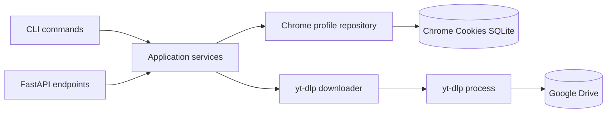
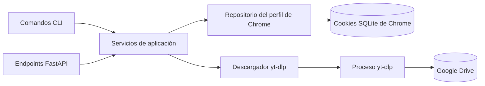

<p align="center">
  
</p>

# gdrive-dl

**Private Google Drive downloads without the usual session headaches.**

[](https://lococoi.github.io/gdrive-dl/)

Full documentation, CLI reference, API contracts, and architecture notes live at
**https://lococoi.github.io/gdrive-dl/**.

`gdrive-dl` is a command-line tool and local HTTP API for downloading private Google Drive files with an isolated Chrome profile. It wraps `yt-dlp` with safe defaults, validates the Google session before downloading, and exposes the same download engine through a typed, testable Python package.

[](https://github.com/lococoi/gdrive-dl/actions/workflows/ci.yml)
[](https://www.python.org/)
[](LICENSE)
[](https://github.com/lococoi/gdrive-dl/releases)

[English](#english) | [Español](#español)

---

## English

### Why this project exists

Downloading a private Google Drive file is not just an HTTP request. Google requires an authenticated browser session, `yt-dlp` needs access to that session, and a fragile cookie setup produces errors that are difficult to diagnose.

`gdrive-dl` separates those concerns:

- It creates an isolated Chrome profile for Google authentication.
- It verifies the saved session against Chrome's cookie database before downloading.
- It runs `yt-dlp` with explicit timeouts, retry behavior, output paths, and safe URL validation.
- It exposes the same services through a CLI, a local FastAPI server, and a standalone Windows executable.

### Features

- Isolated Chrome profile. Your daily browser profile is not modified.
- Real session validation. The tool reads Google authentication cookie names from `Default/Network/Cookies` in read-only mode; it does not decrypt or print cookie values.
- Reliable `yt-dlp` resolution. The slim executable embeds the latest Python package, while source runs can also use a binary placed next to the code, found on `PATH`, or selected with `GDRIVE_YTDLP`.
- Process safety. Downloads have configurable timeouts, bounded output capture, process-tree termination, and retry with exponential backoff for transient failures.
- Download safety. HTTPS-only URLs, a Google Drive host allowlist, private-IP rejection, `--no-playlist`, `--no-overwrites`, resumable downloads, and Windows-safe filenames.
- Bounded concurrency. The API limits simultaneous downloads and returns HTTP 429 when the limit is reached.
- Local API security. The server binds to `127.0.0.1` by default. Exposing it on a non-loopback interface requires a bearer token.
- Operational diagnostics. `status` reports session and tool state; `doctor` checks Python, Chrome, `yt-dlp`, the profile, output permissions, API dependencies, and disk space.
- Standalone Windows build. The CI workflow produces a single-file `gdrive-dl.exe` with Python, FastAPI, Uvicorn, and the latest `yt-dlp` package embedded. The slim build keeps only the Google Drive and generic extractors, which cuts the executable size roughly in half.
- Typed OOP architecture. Immutable value objects, abstract ports, dependency injection, typed exceptions, and no global application state.

### Requirements

- Python 3.11 or newer for running from source.
- Google Chrome installed. The login flow launches Chrome directly; Selenium and ChromeDriver are not required.
- `yt-dlp`. The Python package is installed by `pip install -e .`; the standalone executable always embeds the latest release from PyPI at build time. Source runs can also use a binary provided through `PATH` or `GDRIVE_YTDLP`.
- Network access to Google Drive and to PyPI while building the standalone executable.
- Windows for the prebuilt executable. The source package also runs on Linux and macOS with Chrome installed.

### Installation

```bash
git clone https://github.com/lococoi/gdrive-dl.git
cd gdrive-dl
python -m venv .venv
```

Windows PowerShell:

```powershell
.\.venv\Scripts\Activate.ps1
python -m pip install --upgrade pip
python -m pip install -r requirements-dev.txt
```

Linux or macOS:

```bash
source .venv/bin/activate
python -m pip install --upgrade pip
python -m pip install -r requirements-dev.txt
```

For the CLI only, `pip install -e .` is enough. The `api` command requires the optional API dependencies:

```bash
pip install -e ".[api]"
```

Or install only the runtime API requirements:

```bash
pip install -r requirements.txt
```

### Quick start

```bash
python gdrive-dl.py login
python gdrive-dl.py status
python gdrive-dl.py doctor
python gdrive-dl.py download "https://drive.google.com/file/d/<FILE_ID>/view"
```

After installation as a package, the `gdrive-dl` command is also available:

```bash
gdrive-dl status
```

The default data layout is:

```text
chrome_profile/   isolated Chrome profile and Google session
downloads/        downloaded files
logs/             rotating diagnostic logs
```

For the standalone executable, these directories are created next to `gdrive-dl.exe`. Every path can be overridden with environment variables.

### How it works



1. `login` launches Chrome with `--user-data-dir=<profile>` and opens the Google accounts page. You sign in manually and close every Chrome window when finished.
2. `status` opens the Chrome cookie database in read-only mode and counts known Google authentication cookies. This distinguishes a real session from a directory that merely contains files.
3. `download` validates the URL, verifies the session, prepares the output directory, and runs `yt-dlp` with `--cookies-from-browser chrome:<absolute-profile-path>`.
4. `api` builds a FastAPI application with the same services. Requests are validated, mapped to typed HTTP errors, and limited by the configured concurrency semaphore.
5. The standalone executable performs the same work while embedding Python, the API stack, and the latest `yt-dlp` package.

### CLI reference

| Command | Description |
| --- | --- |
| `login [--timeout SECONDS]` | Opens Chrome for Google authentication and verifies the saved session. |
| `download URL [-o DIR] [--timeout SECONDS] [--retries N] [--allow-any-host]` | Downloads a Google Drive file using the saved session. |
| `status [--json]` | Shows session state, cookie count, profile path, and `yt-dlp` version. |
| `doctor [--json]` | Runs environment and configuration diagnostics. |
| `api [--host HOST] [--port PORT]` | Starts the local HTTP API. |
| `--version` | Prints the application version. |

Global options:

| Option | Description |
| --- | --- |
| `-v`, `--verbose` | Enables debug logging. |
| `--log-level LEVEL` | Sets `DEBUG`, `INFO`, `WARNING`, `ERROR`, or `CRITICAL`. |
| `--profile-dir PATH` | Overrides the Chrome profile directory. |

Examples:

```bash
gdrive-dl download "https://drive.google.com/file/d/<FILE_ID>/view" --output-dir "D:\Downloads"
gdrive-dl download "https://example.com/video" --allow-any-host
gdrive-dl status --json
gdrive-dl doctor --json
```

### Configuration

Configuration is resolved in this order: command-line overrides, environment variables, defaults.

| Variable | Default | Purpose |
| --- | --- | --- |
| `GDRIVE_PROFILE_DIR` | `./chrome_profile` | Chrome profile used for Google authentication. |
| `GDRIVE_OUTPUT_DIR` | `./downloads` | Download destination. |
| `GDRIVE_YTDLP` | auto-detected | Path or command used to run `yt-dlp`. |
| `GDRIVE_CHROME` | auto-detected | Path to the Chrome executable. |
| `GDRIVE_LOGIN_TIMEOUT` | `900` | Maximum login time in seconds. |
| `GDRIVE_DOWNLOAD_TIMEOUT` | `3600` | Maximum download time in seconds. |
| `GDRIVE_RETRIES` | `2` | Additional attempts for transient failures. |
| `GDRIVE_RETRY_BACKOFF` | `2.0` | Initial retry delay in seconds. |
| `GDRIVE_MAX_CONCURRENT` | `2` | Maximum simultaneous downloads in the API. |
| `GDRIVE_ALLOWED_HOSTS` | Google Drive hosts | Comma-separated host allowlist. |
| `GDRIVE_ALLOW_ANY_HOST` | `false` | Allows public non-Drive URLs. |
| `GDRIVE_API_HOST` | `127.0.0.1` | API bind address. |
| `GDRIVE_API_PORT` | `8000` | API port. |
| `GDRIVE_API_TOKEN` | unset | Bearer token. Required for non-loopback API hosts. |
| `GDRIVE_LOG_LEVEL` | `INFO` | Log verbosity. |
| `CHROME_PATH` | unset | Additional Chrome path fallback. |

The default allowed hosts are `drive.google.com`, `docs.google.com`, and `drive.usercontent.google.com`. Use `--allow-any-host` or `GDRIVE_ALLOW_ANY_HOST=true` only when you intentionally need other public hosts.

### HTTP API

Start the server:

```bash
pip install -r requirements.txt
python gdrive-dl.py api --host 127.0.0.1 --port 8000
```

For a non-loopback interface, set a token first:

```powershell
$env:GDRIVE_API_TOKEN = "replace-with-at-least-32-random-characters"
python gdrive-dl.py api --host 0.0.0.0 --port 8000
```

Endpoints:

| Method | Path | Authentication | Description |
| --- | --- | --- | --- |
| `GET` | `/healthz` | No | Liveness probe. |
| `GET` | `/status` | Optional | Session and tool status. |
| `POST` | `/download` | Optional | Downloads a URL. |

Request example:

```bash
curl -X POST http://127.0.0.1:8000/download \
  -H "Content-Type: application/json" \
  -H "Authorization: Bearer $GDRIVE_API_TOKEN" \
  -d '{"url":"https://drive.google.com/file/d/<FILE_ID>/view"}'
```

Response example:

```json
{
  "success": true,
  "status": "downloaded",
  "output_path": "C:\\path\\downloads\\file.mp4",
  "attempts": 1,
  "duration_seconds": 12.4,
  "message": "Descarga completada."
}
```

Error mapping:

| Status | Meaning |
| --- | --- |
| `400` | Invalid or unsupported URL. |
| `401` | Missing or invalid bearer token. |
| `409` | No valid Google session. |
| `429` | Concurrency limit reached. |
| `502` | `yt-dlp` reported a download failure. |
| `503` | Required tool or dependency is unavailable. |
| `504` | Download timeout. |

Interactive OpenAPI documentation is available at `http://127.0.0.1:8000/docs` while the server is running. The API is designed for local or trusted-network use, not as a public multi-tenant service.

### Standalone Windows executable

The CI workflow builds a single-file executable on every successful test run and uploads it as the `gdrive-dl-windows-x64` artifact. Tagged releases (`v*`) attach the executable to the GitHub release.

Build locally:

```powershell
python -m pip install -r requirements-dev.txt
python scripts/build_exe.py
.\dist\gdrive-dl.exe --version
```

The build script:

1. Installs the latest `yt-dlp` release from PyPI.
2. Runs PyInstaller with `gdrive-dl.spec`.
3. Produces `dist/gdrive-dl.exe` with Python, FastAPI, Uvicorn, Pydantic, and the latest `yt-dlp` package embedded.

The executable is intentionally slim: it includes the Google Drive, generic, and common extractors, not the complete yt-dlp site list. Run from source with the full package for other providers. For an offline build, pass `--skip-ytdlp-upgrade` to use the already installed package.

The Windows icon is committed as `assets/logo.ico`. Regenerate it from `assets/logo.png` with:

```powershell
python scripts/generate_icon.py
```

The executable is portable but still requires Google Chrome for authentication. Its profile, downloads, and logs are created next to the executable unless environment variables point elsewhere. The executable is not code-signed; Windows SmartScreen may show a warning for local builds.

### Project structure

```text
gdrive_dl/
  errors.py              Typed exception hierarchy
  models.py              Immutable value objects and entities
  ports.py               Abstract ports for infrastructure
  config.py              Immutable configuration and environment parsing
  services.py            Login, download, status, and diagnostics use cases
  container.py           Composition root and dependency injection
  cli.py                 CLI commands, presenter, exit codes
  api.py                 FastAPI application factory and HTTP mapping
  infrastructure/
    chrome.py            Chrome locator, cookie inspector, profile repository
    process.py           Subprocess runner, output tail buffer, sleeper
    yt_dlp.py            yt-dlp locator, downloader, error sanitizer
    fs.py                Output directory preparation
    logging.py           Rotating logging configuration
    progress.py          Null and stream progress reporters
    text.py              ANSI stripping
gdrive-dl.py             Source entry point and PyInstaller entry
gdrive-dl.spec           PyInstaller slim one-file specification
assets/logo.png          Application logo
assets/logo.ico          Multi-resolution Windows icon
scripts/build_exe.py     Standalone executable build script
scripts/generate_icon.py Logo-to-ICO generator
tests/                   Unit and API tests
.github/workflows/ci.yml Test, build, artifact, and release workflow
```

### Design notes

The project uses a strict layered object-oriented design:

- **Domain value objects** are frozen dataclasses with explicit validation.
- **Ports** are abstract base classes for sessions, authentication, downloads, processes, progress, and directory preparation.
- **Application services** orchestrate use cases and depend only on ports.
- **Infrastructure adapters** implement Chrome, SQLite, subprocess, filesystem, logging, and `yt-dlp` integration.
- **Interfaces** contain the CLI command objects and the FastAPI application factory.
- **The composition root** is the only place that selects concrete implementations.

This structure keeps the core testable without Chrome, network access, or `yt-dlp`, and makes it possible to replace the browser or downloader without rewriting the use cases.

### Security model

- The `chrome_profile` directory contains sensitive session cookies. It is ignored by Git and must not be shared or committed.
- `status` reads cookie names only, in read-only mode. It never prints cookie values.
- The API binds to `127.0.0.1` by default. Non-loopback binding requires `GDRIVE_API_TOKEN` with at least 16 characters.
- Tokens are read from the environment, compared in constant time, and never written to logs or responses.
- URLs must use HTTPS. Credentials, private IPs, localhost names, non-standard ports, and Drive folder URLs are rejected.
- External commands are executed without a shell and with a `--` terminator before user-supplied URLs.
- Error messages are sanitized; URL query strings are redacted from logs and API errors.
- Rotating logs are stored under `logs/` and are excluded from version control.

### Limitations

- Google Chrome is required. The tool does not manage passwords or bypass Google's login challenges.
- Chrome 127 and newer can use app-bound cookie encryption. If `yt-dlp` cannot decrypt the profile cookies, use a compatible browser/profile or export cookies through a method supported by `yt-dlp`.
- The API provides a concurrency limit and an optional bearer token, but it is not a hardened public service. It has no user accounts, rate-limit storage, job queue, or download cancellation.
- The standalone executable bundles only the Google Drive, generic, and common extractors to keep its size down. Site-specific extractors for other providers are available when running from source with the full `yt-dlp` package.
- `--allow-any-host` permits other public sites, but it still rejects private IP literals and local hostnames. DNS rebinding is outside the scope of a local tool.
- Folder downloads are intentionally rejected because `yt-dlp` does not provide a reliable Google Drive folder extractor.

### Development and validation

```bash
python -m pip install -r requirements-dev.txt
ruff check gdrive_dl tests scripts gdrive-dl.py
mypy gdrive_dl --ignore-missing-imports
python -m unittest discover -s tests -t . -v
python scripts/build_exe.py
```

The test suite covers URL validation, configuration, session inspection, process timeouts, command construction, retry and concurrency behavior, CLI exit codes, and API error mapping. The CI workflow runs the suite on Ubuntu and Windows, then builds and smoke-tests the Windows executable.

### License

Apache License 2.0. See [LICENSE](LICENSE).

`gdrive-dl` is not affiliated with Google. Google Drive, Chrome, and `yt-dlp` are trademarks or projects of their respective owners.

---

## Español

### Por qué existe este proyecto

Descargar un archivo privado de Google Drive no es solo una petición HTTP. Google exige una sesión de navegador autenticada, `yt-dlp` necesita acceder a esa sesión y una configuración frágil de cookies produce errores difíciles de diagnosticar.

`gdrive-dl` separa esas responsabilidades:

- Crea un perfil de Chrome aislado para autenticarse con Google.
- Verifica la sesión guardada contra la base de cookies de Chrome antes de descargar.
- Ejecuta `yt-dlp` con timeouts, reintentos, rutas de salida y validación segura de URLs.
- Expone los mismos servicios mediante una CLI, un servidor FastAPI local y un ejecutable Windows autocontenido.

### Características

- Perfil de Chrome aislado. Tu perfil diario del navegador no se modifica.
- Validación real de sesión. La herramienta lee nombres de cookies de autenticación de Google desde `Default/Network/Cookies` en modo de solo lectura; no descifra ni imprime sus valores.
- Resolución confiable de `yt-dlp`. El ejecutable slim embebe el paquete de Python más reciente; al ejecutar desde el código fuente también se puede usar un binario junto al código, en `PATH` o indicado con `GDRIVE_YTDLP`.
- Seguridad de procesos. Las descargas tienen timeout configurable, captura acotada de salida, terminación del árbol de procesos y reintentos con backoff exponencial para fallos transitorios.
- Seguridad de descargas. URLs solo HTTPS, allowlist de hosts de Google Drive, rechazo de IPs privadas, `--no-playlist`, `--no-overwrites`, reanudación de descargas y nombres compatibles con Windows.
- Concurrencia limitada. La API limita las descargas simultáneas y devuelve HTTP 429 al alcanzar el límite.
- Seguridad local de la API. El servidor escucha en `127.0.0.1` por defecto. Exponerlo en una interfaz no local exige un token Bearer.
- Diagnóstico operativo. `status` informa el estado de la sesión y de las herramientas; `doctor` comprueba Python, Chrome, `yt-dlp`, el perfil, permisos de salida, dependencias de la API y espacio en disco.
- Build Windows autocontenido. El CI produce un único `gdrive-dl.exe` con Python, FastAPI, Uvicorn y el paquete `yt-dlp` más reciente embebidos. El build slim conserva solo los extractores de Google Drive y genéricos, lo que reduce el tamaño del ejecutable aproximadamente a la mitad.
- Arquitectura OOP tipada. Value objects inmutables, puertos abstractos, inyección de dependencias, excepciones tipadas y ausencia de estado global de la aplicación.

### Requisitos

- Python 3.11 o superior para ejecutar desde el código fuente.
- Google Chrome instalado. El login lanza Chrome directamente; no se necesitan Selenium ni ChromeDriver.
- `yt-dlp`. El paquete de Python se instala con `pip install -e .`; el ejecutable autocontenido siempre embebe la última release de PyPI al momento de compilar. Al ejecutar desde el código fuente también se puede usar un binario proporcionado mediante `PATH` o `GDRIVE_YTDLP`.
- Acceso a Google Drive y a PyPI durante la compilación del ejecutable autocontenido.
- Windows para el ejecutable precompilado. El paquete fuente también funciona en Linux y macOS con Chrome instalado.

### Instalación

```bash
git clone https://github.com/lococoi/gdrive-dl.git
cd gdrive-dl
python -m venv .venv
```

Windows PowerShell:

```powershell
.\.venv\Scripts\Activate.ps1
python -m pip install --upgrade pip
python -m pip install -r requirements-dev.txt
```

Linux o macOS:

```bash
source .venv/bin/activate
python -m pip install --upgrade pip
python -m pip install -r requirements-dev.txt
```

Para usar solo la CLI, `pip install -e .` es suficiente. El comando `api` requiere las dependencias opcionales:

```bash
pip install -e ".[api]"
```

O instala solo los requisitos de ejecución de la API:

```bash
pip install -r requirements.txt
```

### Inicio rápido

```bash
python gdrive-dl.py login
python gdrive-dl.py status
python gdrive-dl.py doctor
python gdrive-dl.py download "https://drive.google.com/file/d/<FILE_ID>/view"
```

Después de instalar el paquete, también está disponible el comando `gdrive-dl`:

```bash
gdrive-dl status
```

La estructura de datos por defecto es:

```text
chrome_profile/   perfil aislado de Chrome y sesión de Google
downloads/        archivos descargados
logs/             logs de diagnóstico rotativos
```

Para el ejecutable autocontenido, estas carpetas se crean junto a `gdrive-dl.exe`. Todas las rutas se pueden cambiar con variables de entorno.

### Cómo funciona



1. `login` lanza Chrome con `--user-data-dir=<perfil>` y abre la página de cuentas de Google. El usuario inicia sesión manualmente y cierra todas las ventanas de Chrome al terminar.
2. `status` abre la base de cookies de Chrome en modo de solo lectura y cuenta las cookies conocidas de autenticación de Google. Así se distingue una sesión real de una carpeta que solo contiene archivos.
3. `download` valida la URL, verifica la sesión, prepara la carpeta de salida y ejecuta `yt-dlp` con `--cookies-from-browser chrome:<ruta-absoluta-del-perfil>`.
4. `api` construye una aplicación FastAPI con los mismos servicios. Las peticiones se validan, se convierten en errores HTTP tipados y se limitan con el semáforo de concurrencia configurado.
5. El ejecutable autocontenido realiza el mismo trabajo con Python, el stack de la API y el paquete `yt-dlp` más reciente embebidos.

### Referencia de la CLI

| Comando | Descripción |
| --- | --- |
| `login [--timeout SEGUNDOS]` | Abre Chrome para autenticarse con Google y verifica la sesión guardada. |
| `download URL [-o DIR] [--timeout SEGUNDOS] [--retries N] [--allow-any-host]` | Descarga un archivo de Google Drive usando la sesión guardada. |
| `status [--json]` | Muestra el estado de la sesión, la cantidad de cookies, la ruta del perfil y la versión de `yt-dlp`. |
| `doctor [--json]` | Ejecuta diagnósticos de entorno y configuración. |
| `api [--host HOST] [--port PUERTO]` | Inicia la API HTTP local. |
| `--version` | Muestra la versión de la aplicación. |

Opciones globales:

| Opción | Descripción |
| --- | --- |
| `-v`, `--verbose` | Activa logs de depuración. |
| `--log-level NIVEL` | Establece `DEBUG`, `INFO`, `WARNING`, `ERROR` o `CRITICAL`. |
| `--profile-dir RUTA` | Cambia el directorio del perfil de Chrome. |

Ejemplos:

```bash
gdrive-dl download "https://drive.google.com/file/d/<FILE_ID>/view" --output-dir "D:\Descargas"
gdrive-dl download "https://example.com/video" --allow-any-host
gdrive-dl status --json
gdrive-dl doctor --json
```

### Configuración

La configuración se resuelve en este orden: opciones de línea de comandos, variables de entorno y valores por defecto.

| Variable | Valor por defecto | Propósito |
| --- | --- | --- |
| `GDRIVE_PROFILE_DIR` | `./chrome_profile` | Perfil de Chrome usado para la autenticación. |
| `GDRIVE_OUTPUT_DIR` | `./downloads` | Destino de las descargas. |
| `GDRIVE_YTDLP` | autodetectado | Ruta o comando para ejecutar `yt-dlp`. |
| `GDRIVE_CHROME` | autodetectado | Ruta al ejecutable de Chrome. |
| `GDRIVE_LOGIN_TIMEOUT` | `900` | Tiempo máximo de login en segundos. |
| `GDRIVE_DOWNLOAD_TIMEOUT` | `3600` | Tiempo máximo de descarga en segundos. |
| `GDRIVE_RETRIES` | `2` | Intentos adicionales para fallos transitorios. |
| `GDRIVE_RETRY_BACKOFF` | `2.0` | Espera inicial entre reintentos, en segundos. |
| `GDRIVE_MAX_CONCURRENT` | `2` | Descargas simultáneas máximas en la API. |
| `GDRIVE_ALLOWED_HOSTS` | hosts de Google Drive | Allowlist de hosts separada por comas. |
| `GDRIVE_ALLOW_ANY_HOST` | `false` | Permite URLs públicas que no sean de Drive. |
| `GDRIVE_API_HOST` | `127.0.0.1` | Dirección de escucha de la API. |
| `GDRIVE_API_PORT` | `8000` | Puerto de la API. |
| `GDRIVE_API_TOKEN` | sin valor | Token Bearer. Obligatorio para hosts no locales. |
| `GDRIVE_LOG_LEVEL` | `INFO` | Nivel de log. |
| `CHROME_PATH` | sin valor | Ruta alternativa adicional para Chrome. |

Los hosts permitidos por defecto son `drive.google.com`, `docs.google.com` y `drive.usercontent.google.com`. Usa `--allow-any-host` o `GDRIVE_ALLOW_ANY_HOST=true` solo cuando necesites otros hosts públicos de forma intencional.

### API HTTP

Inicia el servidor:

```bash
pip install -r requirements.txt
python gdrive-dl.py api --host 127.0.0.1 --port 8000
```

Para una interfaz no local, define un token primero:

```powershell
$env:GDRIVE_API_TOKEN = "reemplazar-por-al-menos-32-caracteres-aleatorios"
python gdrive-dl.py api --host 0.0.0.0 --port 8000
```

Endpoints:

| Método | Ruta | Autenticación | Descripción |
| --- | --- | --- | --- |
| `GET` | `/healthz` | No | Comprobación de vida. |
| `GET` | `/status` | Opcional | Estado de la sesión y de las herramientas. |
| `POST` | `/download` | Opcional | Descarga una URL. |

Ejemplo de petición:

```bash
curl -X POST http://127.0.0.1:8000/download \
  -H "Content-Type: application/json" \
  -H "Authorization: Bearer $GDRIVE_API_TOKEN" \
  -d '{"url":"https://drive.google.com/file/d/<FILE_ID>/view"}'
```

Ejemplo de respuesta:

```json
{
  "success": true,
  "status": "downloaded",
  "output_path": "C:\\ruta\\downloads\\archivo.mp4",
  "attempts": 1,
  "duration_seconds": 12.4,
  "message": "Descarga completada."
}
```

Mapeo de errores:

| Estado | Significado |
| --- | --- |
| `400` | URL inválida o no soportada. |
| `401` | Token Bearer ausente o inválido. |
| `409` | No hay una sesión válida de Google. |
| `429` | Se alcanzó el límite de concurrencia. |
| `502` | `yt-dlp` informó un fallo de descarga. |
| `503` | Herramienta o dependencia no disponible. |
| `504` | Timeout de descarga. |

La documentación interactiva OpenAPI está disponible en `http://127.0.0.1:8000/docs` mientras el servidor está activo. La API está pensada para uso local o en una red de confianza, no como servicio público multiinquilino.

### Ejecutable Windows autocontenido

El workflow de CI compila un ejecutable único en cada ejecución exitosa de las pruebas y lo publica como artefacto `gdrive-dl-windows-x64`. Las releases etiquetadas (`v*`) adjuntan el ejecutable a la release de GitHub.

Build local:

```powershell
python -m pip install -r requirements-dev.txt
python scripts/build_exe.py
.\dist\gdrive-dl.exe --version
```

El script de build:

1. Instala la última release de `yt-dlp` desde PyPI.
2. Ejecuta PyInstaller con `gdrive-dl.spec`.
3. Genera `dist/gdrive-dl.exe` con Python, FastAPI, Uvicorn, Pydantic y el paquete `yt-dlp` más reciente embebido.

El ejecutable es intencionalmente slim: incluye los extractores de Google Drive, genéricos y comunes, no la lista completa de sitios de yt-dlp. Ejecuta desde el código fuente con el paquete completo para otros proveedores. Para un build sin conexión, usa `--skip-ytdlp-upgrade` para reutilizar el paquete ya instalado.

El icono de Windows está versionado como `assets/logo.ico`. Regénéralo desde `assets/logo.png` con:

```powershell
python scripts/generate_icon.py
```

El ejecutable es portable, pero sigue necesitando Google Chrome para autenticarse. Su perfil, descargas y logs se crean junto al ejecutable salvo que las variables de entorno apunten a otra ruta. El ejecutable no está firmado; Windows SmartScreen puede mostrar una advertencia en builds locales.

### Estructura del proyecto

```text
gdrive_dl/
  errors.py              Jerarquía de excepciones tipadas
  models.py              Value objects y entidades inmutables
  ports.py               Puertos abstractos de infraestructura
  config.py              Configuración inmutable y parseo de entorno
  services.py            Casos de uso de login, descarga, estado y diagnóstico
  container.py           Composition root e inyección de dependencias
  cli.py                 Comandos CLI, presentador y códigos de salida
  api.py                 Fábrica FastAPI y mapeo HTTP
  infrastructure/
    chrome.py            Localizador de Chrome, inspector de cookies, repositorio de perfil
    process.py           Runner de subprocesos, buffer de salida, sleeper
    yt_dlp.py            Localizador y descargador yt-dlp, sanitizador de errores
    fs.py                Preparación de la carpeta de descargas
    logging.py           Configuración de logs rotativos
    progress.py          Reporteros de progreso nulo y de stream
    text.py              Limpieza de ANSI
gdrive-dl.py             Entry point fuente y entry point de PyInstaller
gdrive-dl.spec           Especificación one-file slim de PyInstaller
assets/logo.png          Logo de la aplicación
assets/logo.ico          Icono Windows multirresolución
scripts/build_exe.py     Script de build del ejecutable autocontenido
scripts/generate_icon.py Generador de ICO desde el logo
tests/                   Pruebas unitarias y de API
.github/workflows/ci.yml Workflow de test, build, artefacto y release
```

### Notas de diseño

El proyecto usa una arquitectura OOP estricta por capas:

- **Value objects del dominio** como dataclasses congeladas y validación explícita.
- **Puertos** como clases base abstractas para sesiones, autenticación, descargas, procesos, progreso y preparación de directorios.
- **Servicios de aplicación** que orquestan casos de uso y dependen solo de puertos.
- **Adaptadores de infraestructura** para Chrome, SQLite, subprocesos, filesystem, logging e integración con `yt-dlp`.
- **Interfaces** con comandos CLI como objetos y una fábrica de aplicación FastAPI.
- **Composition root** como único lugar que selecciona las implementaciones concretas.

Esta estructura mantiene el núcleo testeable sin Chrome, sin red y sin `yt-dlp`, y permite reemplazar el navegador o el descargador sin reescribir los casos de uso.

### Modelo de seguridad

- El directorio `chrome_profile` contiene cookies de sesión sensibles. Está ignorado por Git y no debe compartirse ni commitearse.
- `status` lee solo nombres de cookies, en modo de solo lectura. Nunca imprime sus valores.
- La API escucha en `127.0.0.1` por defecto. Para escuchar en una interfaz no local se exige `GDRIVE_API_TOKEN` de al menos 16 caracteres.
- Los tokens se leen del entorno, se comparan en tiempo constante y nunca se escriben en logs ni en respuestas.
- Las URLs deben usar HTTPS. Se rechazan credenciales, IPs privadas, nombres localhost, puertos no estándar y URLs de carpetas de Drive.
- Los comandos externos se ejecutan sin shell y con un terminador `--` antes de la URL proporcionada por el usuario.
- Los mensajes de error se sanean; las query strings de las URLs se redactan en logs y errores de la API.
- Los logs rotativos se guardan en `logs/` y están excluidos del control de versiones.

### Limitaciones

- Google Chrome es obligatorio. La herramienta no gestiona contraseñas ni evita los desafíos de login de Google.
- Chrome 127 y posteriores pueden usar cifrado de cookies vinculado a la aplicación. Si `yt-dlp` no puede descifrar las cookies del perfil, usa un navegador o perfil compatible, o exporta cookies mediante un método soportado por `yt-dlp`.
- La API ofrece límite de concurrencia y token Bearer opcional, pero no es un servicio público endurecido. No tiene cuentas de usuario, almacenamiento de rate limits, cola de trabajos ni cancelación de descargas.
- El ejecutable autocontenido incluye solo los extractores de Google Drive, genéricos y comunes para reducir su tamaño. Los extractores específicos de otros proveedores están disponibles al ejecutar desde el código fuente con el paquete completo de `yt-dlp`.
- `--allow-any-host` permite otros sitios públicos, pero sigue rechazando IPs privadas y nombres locales. DNS rebinding queda fuera del alcance de una herramienta local.
- Las descargas de carpetas se rechazan intencionalmente porque `yt-dlp` no ofrece un extractor confiable para carpetas de Google Drive.

### Desarrollo y validación

```bash
python -m pip install -r requirements-dev.txt
ruff check gdrive_dl tests scripts gdrive-dl.py
mypy gdrive_dl --ignore-missing-imports
python -m unittest discover -s tests -t . -v
python scripts/build_exe.py
```

La suite cubre validación de URLs, configuración, inspección de sesión, timeouts de procesos, construcción del comando, reintentos y concurrencia, códigos de salida de la CLI y mapeo de errores de la API. El CI ejecuta la suite en Ubuntu y Windows, luego compila y hace smoke test del ejecutable de Windows.

### Licencia

Apache License 2.0. Consulta [LICENSE](LICENSE).

`gdrive-dl` no está afiliado a Google. Google Drive, Chrome y `yt-dlp` son marcas o proyectos de sus respectivos propietarios.
